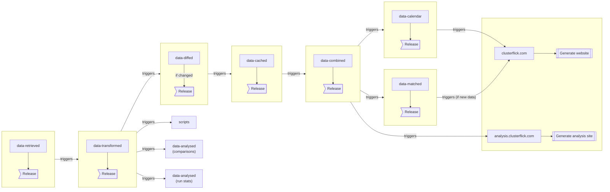

# Clusterflick

**[Clusterflick](https://clusterflick.com)** is a free, open-source site listing
every film showing in London, from 450+ venues in one search: chains,
independents, film clubs, festivals and pop-ups. Each film shows its screenings
across every venue, with ratings from IMDb, Letterboxd, Rotten Tomatoes and
Metacritic, and filters for subtitled, audio-described, relaxed and
baby-friendly showings.

🎬 Looking for something to watch? Head to **https://clusterflick.com** 🍿

This organisation holds the code behind it. Listings are pulled from each
venue's own website several times a day, put into one format, matched to The
Movie Database, and built into a static site. The pipeline runs in the open as a
chain of GitHub Actions, one repository per stage (see [Pipeline](#pipeline)).

[&labelColor=343b43>)](https://github.com/clusterflick/data-analysed/actions/workflows/venue-health.yml)
[&labelColor=343b43>)](https://github.com/clusterflick/data-analysed/actions/workflows/llm-usage-log.yml)

## Using the Data

📄 For data you can use, see
**[clusterflick.com/data-licence](https://clusterflick.com/data-licence)**.

Most of the repositories below are internal build artifacts, published because
the pipeline runs in the open rather than offered for reuse. Each one carries a
`LICENSE-DATA` file saying which it is.

The code in every repository is separately available under the MIT licence.

## Repositories

**The site**

- [clusterflick.com](https://github.com/clusterflick/clusterflick.com) — the
  website
- [api-tmdb-search](https://github.com/clusterflick/api-tmdb-search) — the
  Cloudflare Worker behind the site's film search
- [branding](https://github.com/clusterflick/branding) — brand guide, logos and
  icons

**The data pipeline**

- [scripts](https://github.com/clusterflick/scripts) — the code behind every
  stage, with a module for each venue and ticketing source
- [data-retrieved](https://github.com/clusterflick/data-retrieved) — pulls raw
  listings from venue websites and ticketing platforms
- [data-transformed](https://github.com/clusterflick/data-transformed) — puts
  each venue's listings into one format and matches films to TMDB
- [data-diffed](https://github.com/clusterflick/data-diffed) — records what
  changed between runs
- [data-cached](https://github.com/clusterflick/data-cached) — caches TMDB
  metadata for every film
- [data-combined](https://github.com/clusterflick/data-combined) — merges every
  venue into the single dataset the site is built from
- [data-matched](https://github.com/clusterflick/data-matched) — adds ratings
  from IMDb, Letterboxd, Rotten Tomatoes and Metacritic
- [data-calendar](https://github.com/clusterflick/data-calendar) — calendar
  feeds, one per venue
- [host-non-web-sources](https://github.com/clusterflick/host-non-web-sources) —
  hand-transcribed listings for venues with nothing on the web to read

**Tooling and operations**

- [data-analysed](https://github.com/clusterflick/data-analysed) — finds new
  venues, checks listings against other sources, tracks pipeline reliability
- [manage.clusterflick.com](https://github.com/clusterflick/manage.clusterflick.com)
  — internal review site for the pipeline
- [analysis.clusterflick.com](https://github.com/clusterflick/analysis.clusterflick.com)
  — the original site, kept for reviewing the combined data
- [generate-spotlights](https://github.com/clusterflick/generate-spotlights) —
  social media posts
- [self-hosted-workflows](https://github.com/clusterflick/self-hosted-workflows)
  — workflows for the Raspberry Pi runners
- [themoviedb-data](https://github.com/clusterflick/themoviedb-data) — TMDB
  catalogue download for experimentation
- [release-downloader](https://github.com/clusterflick/release-downloader) —
  fork of a GitHub Action for downloading release assets
- [.github](https://github.com/clusterflick/.github) — this profile and shared
  reusable workflows

## Build Status

1. 
   [&labelColor=343b43>)](https://github.com/clusterflick/data-analysed/actions/workflows/workflow-run-stats.yml)
   [&labelColor=343b43>)](https://github.com/clusterflick/data-analysed/actions/workflows/workflow-run-stats.yml)
2. 
   [&labelColor=343b43>)](https://github.com/clusterflick/data-analysed/actions/workflows/workflow-run-stats.yml)
   [&labelColor=343b43>)](https://github.com/clusterflick/data-analysed/actions/workflows/workflow-run-stats.yml)
   - 
     [&labelColor=343b43>)](https://github.com/clusterflick/data-analysed/actions/workflows/workflow-run-stats.yml)
     _(only releases when something changed)_
     - 
       _(runs whether or not the diff released)_
   - _also triggers `scripts` PR and `data-analysed`_ analysis scripts
3. 
   [&labelColor=343b43>)](https://github.com/clusterflick/data-analysed/actions/workflows/workflow-run-stats.yml)
   - 
     [&labelColor=343b43>)](https://github.com/clusterflick/data-analysed/actions/workflows/workflow-run-stats.yml)
     [&labelColor=343b43>)](https://github.com/clusterflick/data-analysed/actions/workflows/workflow-run-stats.yml)
     - (only releases once per day)
   - 
     [&labelColor=343b43>)](https://github.com/clusterflick/data-analysed/actions/workflows/workflow-run-stats.yml)
     - `clusterflick.com`
       
       [&labelColor=343b43>)](https://github.com/clusterflick/data-analysed/actions/workflows/workflow-run-stats.yml)
   - `analysis.clusterflick.com`
     
     [&labelColor=343b43>)](https://github.com/clusterflick/data-analysed/actions/workflows/workflow-run-stats.yml)

## Pipeline

## Tooling Status

### Development

- `scripts`
  
- `clusterflick.com`
  

### Social Media / Spotlights

- 
- 
- 

### Data Maintenance

- 
  _(daily at 11am UTC)_
- 
  _(manual)_
- 
  _(after each transform)_
- [&labelColor=343b43>)](https://github.com/clusterflick/data-analysed/actions/workflows/compare-accessible-screenings.yml)
  _(after each transform)_
- [&labelColor=343b43>)](https://github.com/clusterflick/data-analysed/actions/workflows/compare-cinemaguide-screenings.yml)
  _(after each transform)_
- 
  _(after each transform)_
- 
  _(after each transform — feeds the stability badges above)_

### Self-hosted Runner Maintenance

- 
- 
- 

## Security Audit (zizmor)

Each repo audits its GitHub Actions workflows with
[zizmor](https://docs.zizmor.sh) via the shared
[`.github`](https://github.com/clusterflick/.github/blob/main/.github/workflows/zizmor.yml)
reusable workflow.

### Pipeline

- data-retrieved
  
- data-transformed
  
- data-calendar
  
- data-cached
  
- data-diffed
  
- data-combined
  
- data-matched
  
- data-analysed
  

### Websites

- clusterflick.com
  
- analysis.clusterflick.com
  

### Tooling

- github
  
- scripts
  
- generate-spotlights
  
- self-hosted-workflows
  
- release-downloader
  
